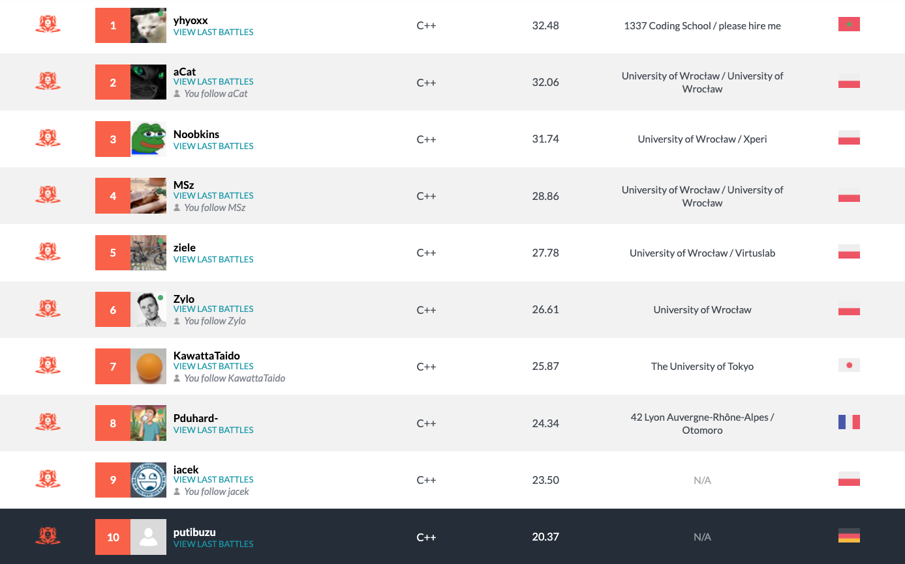

# Cultist Wars bot

A bot for the [CodinGame Cultist Wars arena](https://www.codingame.com/multiplayer/bot-programming/cultist-wars):
an exact simulator of the referee (including its "random" neutral moves), an alpha-beta
search and a small NNUE-style neural evaluation trained on self-play and on its own arena
games, all in one C++ file under the 100k-character limit.

**Result:** rank **1 / 401** on 2026-11-14 as `yhyoxx` (v2.8a: 32.48, ahead of 32.06 and
31.74), up from rank 181 in Bronze about thirty hours earlier.
[`versions/v2.8.cpp`](versions/v2.8.cpp) is the submitted source, without its weights.

> The sources in `versions/` from v2.0 on do not embed their network weights. The trained
> nets are kept separately in [`tools/nets/`](tools/nets); `make pack` rebuilds the live
> submission from `bot.cpp` and `tools/nets/n12a.bin`.

| Stage | Arena score | Rank |
|---|---|---|
| 2022 submission | 22.6 (Bronze) | 181 |
| Exact simulator + alpha-beta, handcrafted eval (v1.0) | 21.6 (Legend) | 9 |
| First net, 32 hidden (v2.0) | 26.9 | 5 |
| 64 hidden, generation 1 (v2.1) | 28.9 | 4 |
| + deep-search data (v2.2) | 29.75 | 4 |
| Generation 3 + search changes (v2.3) | 30.89 | 2 |
| + 13% speed, generation-5 net (v2.4) | 30.91 | 3 |
| New training recipe, history penalties, singular extensions (v2.5) | 31.56 | 3 |
| Own arena games, re-searched, in the training data (v2.8a) | **32.48** | **1** |

Full version table, including the versions that were reverted: [docs/history.md](docs/history.md).

<details>
<summary>Leaderboard, 2026-11-14</summary>



</details>

## The game

13×7 grid with random symmetric obstacles, 14 units: one cult leader per player and 12
neutral cultists. One action per turn for the whole side: move one unit one step, shoot
with a cultist (damage 7 − distance, range 6, Bresenham line of sight), or convert an
adjacent cultist with the leader. After every action one neutral unit may step. 150 turns
in total; most units wins. 1000 ms for the first turn, 50 ms after.
[Statement](docs/statement.md), [official referee](https://bitbucket.org/Nixerrr/cultist-wars).

The neutral moves look random but come from a generator with a hard-coded seed, unrelated
to the game seed. Carrying that generator in the position makes the game deterministic with
perfect information, so it can be searched like chess: see [docs/engine.md](docs/engine.md).

## How it works

```
 self-play (bot.cpp, CW_GEN) ────────────┐
 our arena battles, rebuilt and          ├──►  data/*.bin  ──►  tools/train.py  ──►  tools/nets/*.bin
 searched again (arena_data.py --label) ─┘                                               │
          ▲                                                                              │
          └───────────────── the newest net plays the next generation ◄──────────────────┤
                                                                                         ▼
 arena run (~120 battles, keep or revert)  ◄──  tools/pack.py (net embedded)  ◄──  self-play check
```

- **Engine.** A bit-exact port of the Java referee: bullet lines, the neutral-move
  generator, every edge case. Opponent actions are not in the input; the bot recovers them
  by replaying every legal action against the units it receives. Checked against real game
  logs with zero desyncs. → [docs/engine.md](docs/engine.md)
- **Search.** Iterative-deepening PVS over single actions, about 3 million nodes per
  second in arena games: transposition table, quiescence on shots and conversions, LMR,
  futility, late move pruning, null move (a real `WAIT`), singular extensions, history
  with penalties. Each feature has a measured Elo. → [docs/search.md](docs/search.md)
- **Evaluation.** 1,911 sparse inputs (unit type × hit-point bucket × cell, plus
  obstacles) → 64 hidden, one accumulator per side, SCReLU → 4 output heads by game phase.
  int8/int16, updated incrementally; the weights are stored at 15 bits per character to
  fit the file limit. → [docs/nnue.md](docs/nnue.md)
- **Data.** Self-play on Kaggle CPUs, 20k to 100k nodes per move, about 65M positions in
  all; each position is stored with its search score and the game's result. Plus every
  position of our own arena battles (1,622 games, 224k positions for the live net): battle
  logs hold only a seed and the moves, so a port of the map generator rebuilds each game
  and every position is searched again at 300k nodes for its label.
- **Judging a version.** Self-play only screens out regressions. The arena decides: one
  run is about 120 battles in 35 minutes, compared with the live version on the same mix
  of opponents and seats. → [docs/pipeline.md](docs/pipeline.md)

## What decided the result

1. **The seed.** Reading the referee's source, not the statement, showed the neutral moves
   are predictable. Everything else (alpha-beta, exact labels, deep tactics around neutral
   units) rests on it.
2. **A learned evaluation.** The handcrafted evaluation topped out at 21.6; every
   weight tweak was flat. The first net trained on 8M positions of that same bot scored
   26.9, and the next three net generations added four more points.
3. **Self-play stopped predicting the arena.** From v2.4 on, self-play gains of 30–45 Elo
   turned into anything between +0.7 and −2 arena points (v2.6: +34 Elo, −2 points, lost
   first-seat games it led). A pool of older versions and net accuracy on held-out real
   games failed as predictors too. Only the arena run was kept as the gate.
4. **The arena is noisy.** The same code submitted three times scored 30.65, 31.56 and
   31.97. A single run separates only differences of about 50 Elo, so most "gains" are
   unknowable; what moves the score must be large.
5. **Real positions in the training data.** The last step came from training on positions
   the players above us create, which self-play never reaches (damaged units rotated out of
   range, focused fire), labelled by a deep search rather than by the game's result: the
   result label had overfitted. 0.3% of the data, repeated ten times; +4 Elo in self-play,
   two arena runs at 31.82 (drifting to 32.51) and 32.48.

## Quick start

Needs a C++17 compiler; Python 3 with `numpy` (packing) and `torch` (training).

```sh
make                 # build/bot, build/referee (handcrafted eval), build/gen, build/referee_lab (net)
make pack            # out/submission.cpp: the live v2.8a, 94.7k characters

# the live version as a local binary, against the handcrafted eval at 20k nodes per move
python3 tools/pack.py -n tools/nets/n12a.bin -H 64 --keep-local -o out/v2.8a_local.cpp
c++ -O3 -std=c++17 -march=native -DLOCAL -o build/v2.8a out/v2.8a_local.cpp
./build/referee build/v2.8a build/bot -g 100 -n 20000 -j 8
```

One improvement cycle:

```sh
# 1. self-play: 500 games, 100k nodes per move, seed 1, played by the current net
CW_NET=tools/nets/n12a.bin CW_GEN=500:100000:1:data/g_1.bin ./build/gen

# 2. own arena battles (CodinGame API token in ~/.config/codingame/token), searched again
python3 tools/arena.py fetch && python3 tools/arena_data.py fetch
CW_NET=tools/nets/n12a.bin python3 tools/arena_data.py export data/arena_lab.bin --label 300000 -j 8

# 3. train (the recipe of the v2.8a net)
python3 tools/train.py -o tools/nets/new.bin 'data/*.bin' --hidden 64 --epochs 40 --lam 0.4 \
        --k 800 --margin-w 1.0 --margin-c 0.7 --rep arena_lab:10

# 4. regression check at fixed nodes, then the submission
python3 tools/pack.py -n tools/nets/new.bin -H 64 --keep-local -o out/new_local.cpp
c++ -O3 -std=c++17 -march=native -DLOCAL -o build/new out/new_local.cpp
python3 tools/league.py match build/new build/v2.8a -g 1600 -n 20000
python3 tools/pack.py -n tools/nets/new.bin -H 64 -o out/new.cpp
python3 tools/cg.py submit out/new.cpp      # also mirrors the code into the CodinGame IDE
```

At scale the same steps run on Kaggle: `tools/kaggle_gen.py` (CPU kernels),
`tools/kaggle_train.py` (GPU). See [docs/workflow.md](docs/workflow.md).

## Layout

| Path | What |
|---|---|
| `bot.cpp` | The whole bot: simulator, move generator, search, evaluation, protocol; self-play generator under `#ifdef LOCAL` |
| `tools/nets/` | Trained nets (`.bin`); n12a is the live one |
| `versions/` | Every submitted version as a single file. v1.x are complete; v2.0+ have the weight literal cut (they show the code, they do not compile) |
| `tools/referee.cpp` | Native referee (includes `bot.cpp` for the rules), log replay check, export, analysis and search labelling of recorded games |
| `tools/league.py`, `tools/sweep.sh` | Frozen versions, matches with Elo, parameter sweeps |
| `tools/train.py`, `tools/pack.py` | PyTorch trainer (exports the quantized net); single-file submission builder |
| `tools/cg.py` | CodinGame API: test games, submit (and IDE mirror), progress, opponents, leaderboard |
| `tools/arena.py`, `tools/arena_data.py`, `tools/mapgen.py` | Our arena battles: archive, per-opponent scores, games rebuilt from seed + moves as records, labels and start positions |
| `tools/strata.py`, `tools/netscore.py` | Arena runs compared on the same mix of games; nets scored on held-out real battles |
| `tools/checklog.py`, `tools/gauntlet.py` | Exactness gate on real logs; candidates against arena bots in test games |
| `tools/kaggle_gen.py`, `kaggle_train.py`, `kaggle_match.py` | Data generation, training and gate matches on Kaggle |
| `docs/` | How each part works, what was measured, what to try next |

## Docs

1. [Pipeline](docs/pipeline.md) — how a change becomes a version, and the decision rules
2. [Engine](docs/engine.md) — the referee port, the neutral-move generator, staying in sync
3. [Search](docs/search.md) — every technique, with Elo
4. [NNUE](docs/nnue.md) — architecture, quantization, data, training, embedding, every net
5. [Workflow](docs/workflow.md) — tool reference, Kaggle, CodinGame specifics
6. [History](docs/history.md) — versions, arena results, what worked and what did not
7. [Roadmap](docs/future.md) — open ideas
8. [Statement](docs/statement.md) — the game rules
